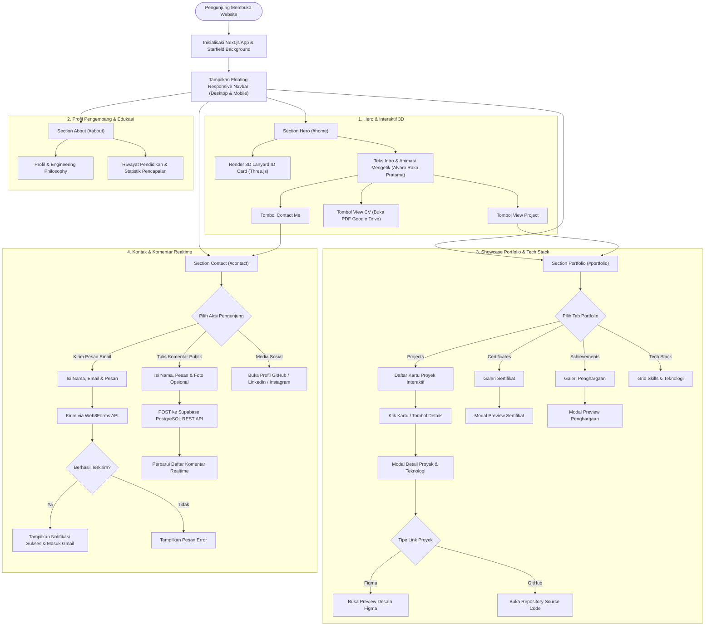

<div align="center">

# Developer Portfolio Website

**Portofolio Web Modern, Interaktif & Responsif — Dirancang dengan Arsitektur Dark-Mode Futuristik dan Simulasi 3D.**

[](https://nextjs.org/)
[](https://react.dev/)
[](https://www.typescriptlang.org/)
[](https://tailwindcss.com/)
[](https://threejs.org/)

[Live Demo](#live-demo) • [Fitur Utama](#fitur-utama) • [Tech Stack](#tech-stack) • [Cara Menjalankan](#cara-menjalankan-secara-lokal) • [Alur Aplikasi](#alur-aplikasi-flowchart) • [Kontak](#kontak-pengembang)

</div>

---

## Tentang Proyek

**Developer Portfolio Website** adalah situs portofolio pribadi milik **Alvaro Raka Pratama** (Rekayasa Perangkat Lunak) yang dibangun untuk menampilkan karya proyek, kompetensi teknis, sertifikasi, dan pencapaian secara profesional. Website ini mengedepankan desain *dark-mode* berlatar bintang dinamis serta interaksi visual berbasis WebGL.

---

## Fitur Utama

1. **Tampilan Modern Dark-Mode & Interactive 3D Hero**
   - Kartu ID bergaya *lanyard* 3D interaktif berbasis Three.js yang merespons tarikan dan gerakan kursor dengan fisika realistis.
   - Animasi ketik (*typing effect*), tombol akses cepat ke proyek, tautan CV, serta latar belakang *starfield* dinamis.
2. **Showcase Proyek Interaktif**
   - Kartu proyek interaktif dengan efek *spotlight* dan pratinjau visual.
   - Modal detail proyek lengkap dengan ringkasan, daftar teknologi yang digunakan, serta tautan langsung menuju **Preview / Live Demo** (Figma) dan **Source Code** (GitHub).
   - Dilengkapi tab khusus untuk **Certificates**, **Achievements**, dan **Tech Stack**.
3. **Bagian Profil Pengembang & Skills / Tech Stack**
   - Ringkasan profil pengembang, filosofi rekayasa perangkat lunak, statistik pencapaian, serta riwayat pendidikan.
   - Etalase kemampuan (*Tech Stack*) terstruktur mencakup pengembangan web, mobile, dan manajemen basis data.
4. **Formulir Kontak & Navigasi Responsif**
   - Navigasi melayang (*floating capsule navbar*) yang responsif dan adaptif untuk tampilan desktop, tablet, maupun mobile.
   - Formulir kirim pesan langsung (*Contact Me*) terintegrasi ke email dan kolom komentar publik berbasis cloud.

---

## Tech Stack

| Kategori | Teknologi |
| :--- | :--- |
| **Framework & Library** | Next.js 16 (App Router), React 19 |
| **Bahasa Pemrograman** | TypeScript 5, JavaScript (ES6+), HTML5, CSS3 |
| **Styling & UI** | Tailwind CSS v4, Lucide React Icons |
| **Grafis 3D & Animasi** | Three.js (WebGL), GSAP |
| **Database & API** | Supabase (PostgreSQL REST API), Web3Forms API |

---

## Alur Aplikasi (Flowchart)



---

## Cara Menjalankan Secara Lokal

Pastikan Anda sudah menginstal **Node.js** (disarankan versi 20 atau terbaru) dan **Git** di komputer Anda.

1. **Clone repositori ini**
   ```bash
   git clone https://github.com/seevaroo/Portofolio.git
   cd Portofolio
   ```

2. **Install semua dependencies**
   ```bash
   npm install
   ```

3. **Konfigurasi Environment Variables *(Opsional untuk fitur Contact & Komentar)***
   Buat file `.env.local` di root folder proyek, lalu isi kredensial berikut:
   ```env
   NEXT_PUBLIC_WEB3FORMS_KEY=your_web3forms_access_key
   NEXT_PUBLIC_SUPABASE_URL=your_supabase_project_url
   NEXT_PUBLIC_SUPABASE_ANON_KEY=your_supabase_anon_key
   ```

4. **Jalankan server development**
   ```bash
   npm run dev
   ```

5. **Buka di browser**
   Akses [http://localhost:3000](http://localhost:3000) untuk melihat hasilnya.

---

## Live Demo

<<<<<<< HEAD
- **Production URL:** [`https://your-portfolio-demo.netlify.app`](https://your-portfolio-demo.netlify.app) *(Ganti dengan URL hosting Netlify/Vercel Anda)*
=======
- **Production URL:** [`https://alvaroraka-portofolio.netlify.app/`](https://alvaroraka-portofolio.netlify.app/)) *(Ganti dengan URL hosting Netlify/Vercel Anda)*
>>>>>>> 158d1f2f15ae01702d1146035554b1f5bdea264a

---

## Struktur Proyek

```text
.
├── app/                # Konfigurasi App Router, layout utama & global styles
├── components/         # Komponen UI modular (Hero, About, Portfolio, Contact, Navbar, Lanyard 3D)
├── public/             # Aset statis (gambar proyek, sertifikat, ikon teknologi, tekstur 3D)
├── scripts/            # Script utilitas build & aset
├── next.config.ts      # Konfigurasi Next.js
├── package.json        # Daftar dependencies & scripts
└── tsconfig.json       # Konfigurasi TypeScript
```

---

## Kontak Pengembang

Dibuat oleh **Alvaro Raka Pratama** — *Rekayasa Perangkat Lunak*

- **GitHub:** [github.com/seevaroo](https://github.com/seevaroo)
- **LinkedIn:** [linkedin.com/in/seevaroo](https://www.linkedin.com/in/seevaroo/)
- **Instagram:** [@seevaroo](https://instagram.com/seevaroo)
